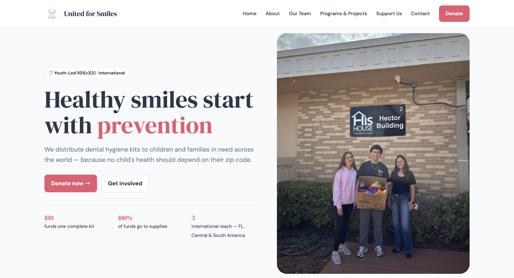
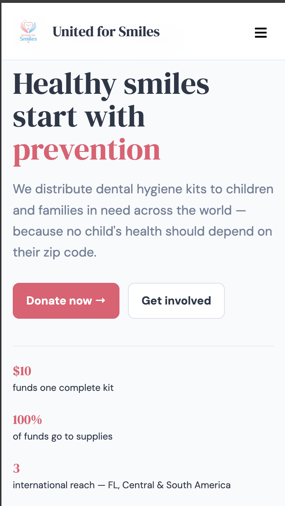

# United for Smiles | Community Outreach Website

A responsive, multi-page website developed for **United for Smiles**, a youth-led 501(c)(3) nonprofit organization founded by Michael Tkachenko. United for Smiles works to improve access to oral-health education and dental hygiene resources for underserved communities.

The website serves as the organization's digital hub, connecting visitors with educational programs, community initiatives, volunteer opportunities, partnerships, and donation resources.

🌐 **Live Website:** [www.unitedforsmiles.com](https://www.unitedforsmiles.com/)

---

## 📸 Website Preview

### Desktop View



### Mobile View



---

## 📖 Project Overview

United for Smiles was established to address inequalities in access to dental hygiene supplies and preventive oral-health education. As the organization expanded its outreach programs and community partnerships, developing an accessible online presence became an important part of connecting with volunteers, donors, and the communities we serve.

As the founder of United for Smiles, I helped lead the development and ongoing maintenance of the organization's website, applying my knowledge of HTML, CSS, and JavaScript to a real-world project.

The development process involved adapting and customizing front-end components, refining responsive layouts, implementing interactive functionality, troubleshooting technical issues, and configuring deployment through GitHub Pages.

The goal was to create a functional, visually consistent, and easy-to-navigate website that could grow alongside the organization.

---

## ✨ Key Features

- 🏠 **Homepage:** Introduces the organization's mission, oral-health initiatives, and opportunities to get involved.

- 📖 **About Page:** Provides background on United for Smiles, its purpose, and its approach to improving oral health.

- 👥 **Team Page:** Introduces the founder and organizational leadership.

- 🦷 **Programs & Projects:** Highlights dental hygiene kit distribution, educational initiatives, and community outreach programs.

- 🤝 **Support Us:** Connects potential volunteers, sponsors, and community partners with opportunities to support the organization.

- 💙 **Donation Resources:** Integrates external donation and supply contribution services, including Zeffy and Amazon wishlist links.

- ✉️ **Contact Page:** Provides contact information and an email-based inquiry form.

- 📱 **Responsive Design:** Uses CSS Grid, Flexbox, and media queries to adapt layouts across different screen sizes.

- 🎞️ **Interactive Sponsor Carousel:** Features automatic rotation, manual navigation controls, responsive card displays, and pause-on-hover functionality.

- 🌐 **Custom Domain:** Hosted through GitHub Pages and connected to www.unitedforsmiles.com.

---

## 🛠️ Tech Stack & Tools

| Technology | Purpose |
| --- | --- |
| HTML5 | Page structure, navigation, and content organization |
| CSS3 | Styling, responsive layouts, Flexbox, Grid, and media queries |
| JavaScript | Mobile navigation, carousel functionality, and dynamic updates |
| Git & GitHub | Version control and project management |
| GitHub Pages | Static website hosting and deployment |
| Zeffy | External donation processing |
| Google Forms | Volunteer and partnership inquiries |
| Amazon Wishlist | Supply donation resources |

The website uses standard HTML, CSS, and JavaScript without requiring a front-end framework, application server, or separate build process.

---

## 📁 Project Structure

```text
unitedforsmiles.v2/
├── index.html          # Homepage
├── about.html          # Organization background and mission
├── team.html           # Founder and leadership profiles
├── programs.html       # Educational programs and outreach
├── support-us.html     # Volunteer and partnership resources
├── donate.html         # Donation and supply contribution links
├── contact.html        # Contact information and email form
├── style.css           # Shared styling and responsive layouts
├── script.js           # Navigation and interactive functionality
├── assets/             # Logos, photographs, and website images
├── CNAME               # GitHub Pages custom domain
├── screenshots/        # Desktop and mobile website previews
└── README.md           # Project documentation
```

---

## ⚙️ Technical Implementation

### Responsive Design

The website uses CSS Grid, Flexbox, and media queries to adjust page layouts, navigation elements, and content across desktop and mobile screens. Shared styling helps maintain visual consistency throughout the seven-page website.

### Interactive Navigation

JavaScript controls the mobile navigation menu, allowing visitors to access the website's pages on smaller devices. The script also handles automatic footer-year updates.

### Sponsor Carousel

The sponsor carousel uses JavaScript to manage card positioning and transitions. Its functionality includes:

- Previous and next navigation controls.
- Automatic carousel advancement.
- Responsive adjustments to the number of visible cards.
- Pause-on-hover interaction.
- Recalculation of card positioning when the browser is resized.

### External Service Integration

The website connects visitors to established external services for donations, volunteer inquiries, and supply contributions.

The site itself does not process payments or maintain a database of donation and volunteer submissions. Its contact form prepares an email using the visitor's email application.

### Hosting and Deployment

The website is deployed through GitHub Pages and connected to a custom domain. Its static architecture allows content and design updates without requiring a dedicated backend server.

---

## 🚀 Installation & Setup

The project can be run locally without installing additional JavaScript dependencies.

**1. Clone the repository**

```bash
git clone https://github.com/mtkach09/United-for-Smiles-Website-Final.git
cd United-for-Smiles-Website-Final
```

**2. Start a local server**

With Python 3 installed:

```bash
python3 -m http.server 8000
```

**3. Open the website**

Navigate to:

http://localhost:8000

The website can now be explored locally.

---

## 🌍 Real-World Application

Unlike a website created solely as a programming demonstration, this project supports the operations of an active nonprofit organization.

United for Smiles organizes oral-health education initiatives, distributes dental hygiene kits, and collaborates with community organizations to improve access to preventive care.

The website helps support these efforts by:

- Making information about the organization's programs publicly accessible.
- Connecting potential volunteers with outreach opportunities.
- Providing resources for donors and community partners.
- Highlighting educational initiatives and community projects.
- Establishing a centralized online presence for the organization.

## 🗺️ Future Development

Potential improvements include:

- [ ] Expand accessibility features, including improved keyboard navigation and reduced-motion support.
- [ ] Refactor repeated navigation and footer elements into reusable components.
- [ ] Improve mobile performance and responsive interactions.
- [ ] Develop more dynamic ways to present outreach statistics and project milestones.
- [ ] Introduce automated testing for interactive website functionality.

---

## 📬 Contact

**United for Smiles**

🌐 Website: [www.unitedforsmiles.com](https://www.unitedforsmiles.com/)

✉️ Email: [info@unitedforsmiles.com](mailto:info@unitedforsmiles.com)

💻 GitHub: [United for Smiles Repository](https://github.com/mtkach09/unitedforsmiles.v2)

---

*Developed and maintained to support United for Smiles' mission of expanding access to oral-health education and preventive dental care.*
